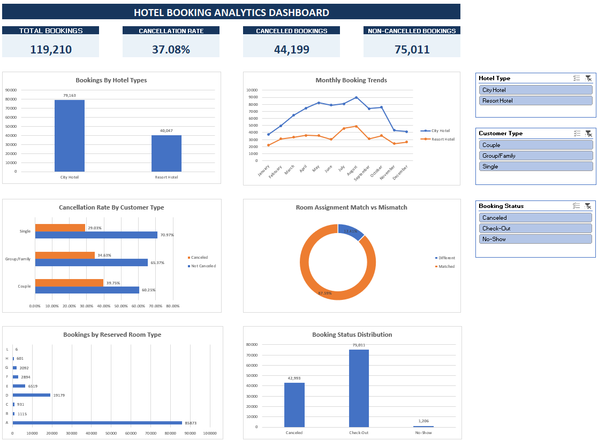

# Hotel Booking Analytics | Excel Dashboard

## Project Overview

This project presents an interactive **Hotel Booking Analytics Dashboard** developed using Microsoft Excel.

## Business Objectives

The analysis focuses on:

- Hotel booking patterns
- Cancellation behaviour
- Customer segmentation
- Room assignment analysis

## Tools and Techniques

**Primary Tool:** Microsoft Excel

- Data Cleaning
- PivotTables
- PivotCharts
- Interactive Slicers

## Dashboard Preview



## Dataset Overview

The project analyzes 119,210 hotel booking records covering City Hotels and Resort Hotels.

The dataset contains information about:

- Hotel type and booking cancellation status
- Arrival year and month
- Customer composition (adults, children, and babies)
- Customer country
- Reserved and assigned room types
- Reservation status and reservation status date

Additional columns were created to support customer segmentation, data quality filtering, and room assignment analysis.

## Key Performance Indicators (KPIs)

The dashboard highlights four important metrics:

| KPI | Value |
|---|---:|
| Total Bookings | 119,210 |
| Cancellation Rate | 37.08% |
| Cancelled Bookings | 44,199 |
| Non-Cancelled Bookings | 75,011 |

**Note:** The cancellation KPI uses the `is_canceled` field. The reservation status analysis separately identifies canceled bookings and no-shows.

## Dashboard Visualizations

The dashboard includes six visualizations:

### 1. Bookings by Hotel Type

Compares booking volumes between City Hotels and Resort Hotels to identify differences in customer demand.

### 2. Monthly Booking Trends

Analyzes monthly booking patterns across both hotel types to identify variations in booking activity.

### 3. Cancellation Rate by Customer Type

Compares cancellation rates across three customer segments:

- Couple
- Group/Family
- Single

### 4. Room Assignment Match vs Mismatch

Examines the percentage of bookings where customers received their originally reserved room type compared with those assigned a different room type.

### 5. Bookings by Reserved Room Type

Identifies the most frequently reserved room categories and highlights differences in room preferences.

### 6. Booking Status Distribution

Analyzes reservation outcomes across three categories:

- Canceled
- Check-Out
- No-Show

## Interactive Dashboard Features

The dashboard includes three interactive slicers:

| Slicer | Filtering Options |
|---|---|
| Hotel Type | City Hotel, Resort Hotel |
| Customer Type | Couple, Group/Family, Single |
| Booking Status | Canceled, Check-Out, No-Show |

These slicers allow users to filter the dashboard and explore booking patterns across different customer and hotel categories.

Multi-selection is also supported.

## Key Business Insights

### 1. City Hotels Generate More Bookings

- City Hotel: 79,163 bookings
- Resort Hotel: 40,047 bookings

City Hotels account for approximately 66.41% of all bookings, indicating higher booking activity than Resort Hotels.

### 2. Cancellation Rates Are Substantial

The overall cancellation rate is 37.08%, representing 44,199 bookings flagged as cancelled.

This highlights the importance of understanding cancellation behaviour and improving reservation management.

### 3. August Has the Highest Booking Volume

August records the highest aggregated monthly booking volume, with 13,861 bookings.

This indicates a peak in booking activity within the monthly analysis.

### 4. Couples Have the Highest Cancellation Rate

Cancellation rates vary by customer segment:

| Customer Type | Cancellation Rate |
|---|---:|
| Couple | 39.75% |
| Group/Family | 34.63% |
| Single | 29.03% |

Couples show the highest cancellation rate among the three customer groups.

### 5. Most Room Assignments Match Reservations

- Matched Room Assignments: 87.59%
- Different Room Assignments: 12.41%

Most bookings have matching reserved and assigned room types. However, room assignment mismatches remain an area worth investigating.

### 6. Room Type A Is the Most Popular

Room Type A accounts for 85,873 reservations (72.04%), followed by Room Type D with 19,179 reservations (16.09%).

This indicates that demand is concentrated in a small number of room categories.

### 7. Check-Out Is the Most Common Reservation Outcome

| Booking Status | Bookings |
|---|---:|
| Check-Out | 75,011 |
| Canceled | 42,993 |
| No-Show | 1,206 |

Check-Out represents the largest share of reservation outcomes.

The Canceled and No-Show categories together account for the 44,199 bookings flagged as cancelled in the cancellation KPI.

## Business Recommendations

Based on the dashboard findings, the following recommendations can support hotel management:

**1. Improve Cancellation Management**
- Investigate the factors contributing to booking cancellations.
- Pay particular attention to customer segments with higher cancellation rates.

**2. Strengthen Demand Planning**
- Use historical monthly booking patterns to support staffing and room allocation decisions.
- Consider periods of higher booking activity when planning operational resources.

**3. Improve Room Allocation**
- Investigate situations where assigned room types differ from reserved room types.
- Monitor room assignment accuracy to identify opportunities for operational improvement.

**4. Optimize Room Inventory**
- Consider high-demand room types when planning inventory and availability.
- Investigate whether existing room allocation practices align with booking preferences.

**5. Monitor Reservation Outcomes**
- Track cancellations and no-shows separately.
- Use booking status analysis to support reservation management decisions.

These recommendations are exploratory and would require additional operational data before implementation.

## Project Structure

```text
Hotel-Booking-Analytics-Excel/
│
├── Excel_Hotel_Booking_Analysis.xlsx
├── Excel_Dashboard_Screenshot.png
└── README.md
```

### File Description

**Excel_Hotel_Booking_Analysis.xlsx**

The main Excel workbook containing:

- Raw_Data
- Cleaned_Data
- Pivot_Analysis
- Dashboard

**Excel_Dashboard_Screenshot.png**

A static preview of the completed Excel dashboard.

**README.md**

Project documentation covering the objectives, methodology, visualizations, key findings, and recommendations.

## How to Explore the Dashboard

1. Download `Excel_Hotel_Booking_Analysis.xlsx`.
2. Open the workbook using Microsoft Excel Desktop.
3. Navigate to the `Dashboard` worksheet.
4. Review the KPI cards and visualizations.
5. Use the interactive slicers to explore different booking categories.
6. Explore the `Pivot_Analysis` worksheet to understand the supporting analysis.
7. Review the `Cleaned_Data` worksheet to examine the prepared dataset.

**Note:** GitHub may not display an online preview of the Excel workbook because of its file size. Download the workbook to view the complete interactive dashboard.

## Conclusion

This project demonstrates the use of Microsoft Excel to transform hotel booking data into meaningful business insights.

Through data cleaning, PivotTable analysis, KPI development, and interactive visualizations, the dashboard provides insights into booking patterns, cancellation behaviour, customer segments, room preferences, and reservation outcomes.

The project highlights practical Excel analytics skills and the application of data-driven analysis to hospitality business decisions.

---

### Skills Demonstrated

**Microsoft Excel | Data Cleaning | Data Analysis | PivotTables | PivotCharts | KPI Development | Interactive Dashboards | Business Analytics**

  
